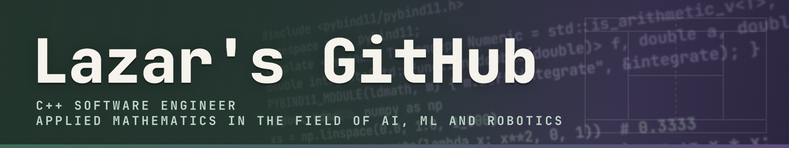
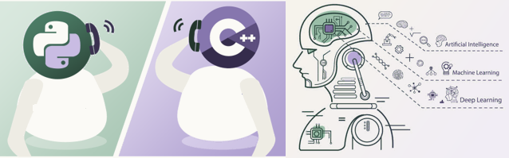
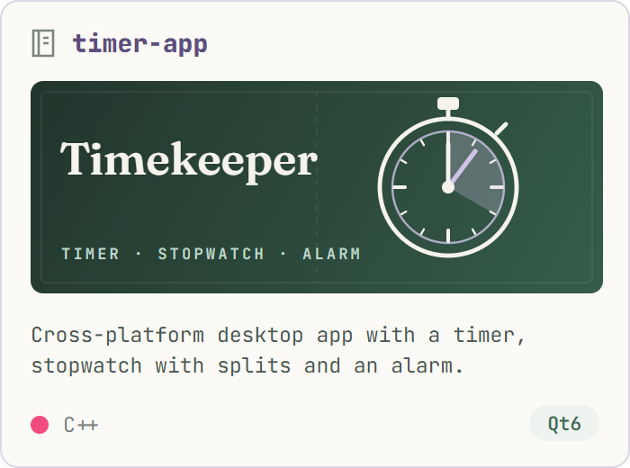
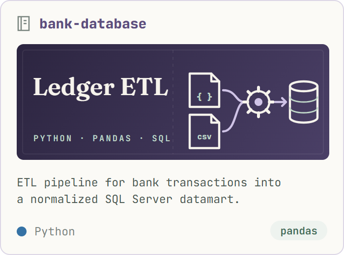
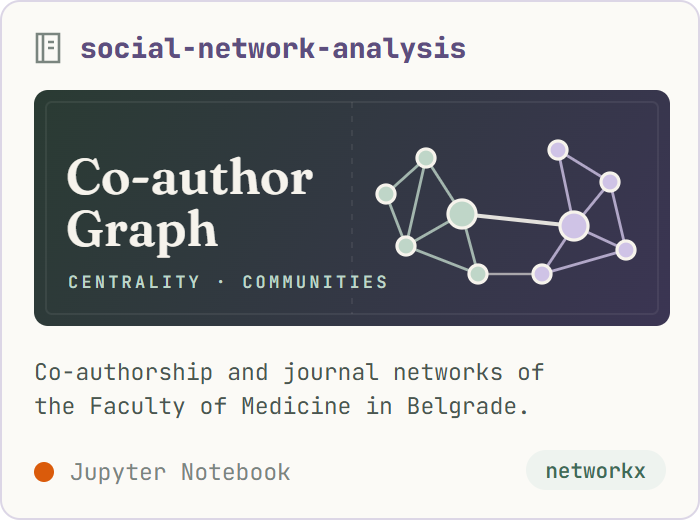
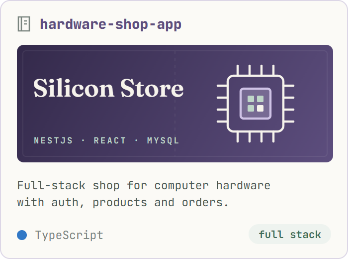
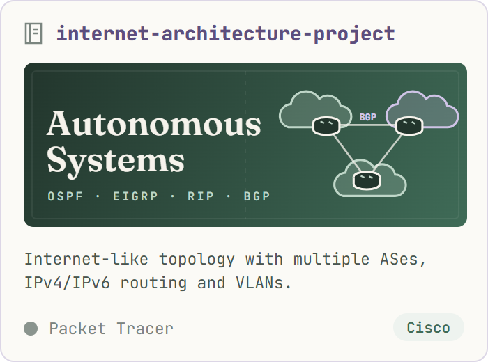
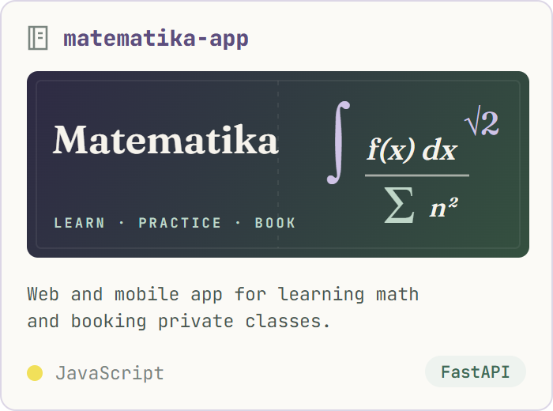

 

Hi, I'm Lazar! 👋 I'm a software engineer passionate about C++ and Python, AI, machine learning and mathematics.
I hold a Master's degree in Software Engineering from the University of Belgrade, and I currently work as a Software Engineer at Logikadigital.
Before that I worked at FIS Global and at the University.

This GitHub account holds my personal and university projects: desktop apps in modern C++, data pipelines and network analysis in Python, and full-stack web applications.

You can contact me on LinkedIn: [Lazar Davidović](https://www.linkedin.com/in/lazar-davidovi%C4%87-831887233/).

## Some projects

  <a href="https://github.com/LazarDavidovic98/timer-app"><picture><source media="(prefers-color-scheme: dark)" srcset="assets/projects/timer-app-dark.png"></picture></a>
  <a href="https://github.com/LazarDavidovic98/bank-database"><picture><source media="(prefers-color-scheme: dark)" srcset="assets/projects/bank-database-dark.png"></picture></a>
   
  <a href="https://github.com/LazarDavidovic98/social-network-analysis"><picture><source media="(prefers-color-scheme: dark)" srcset="assets/projects/social-network-analysis-dark.png"></picture></a>
  <a href="https://github.com/LazarDavidovic98/hardware-shop-app"><picture><source media="(prefers-color-scheme: dark)" srcset="assets/projects/hardware-shop-app-dark.png"></picture></a>
   
  <a href="https://github.com/LazarDavidovic98/internet-architecture-project"><picture><source media="(prefers-color-scheme: dark)" srcset="assets/projects/internet-architecture-project-dark.png"></picture></a>
  <a href="https://github.com/LazarDavidovic98/matematika-app"><picture><source media="(prefers-color-scheme: dark)" srcset="assets/projects/matematika-app-dark.png"></picture></a>

## Languages & tools

  &nbsp;
  &nbsp;
  &nbsp;
  &nbsp;
  &nbsp;
  &nbsp;
  

## Fun facts about me

- 🎨 I enjoy photorealistic drawing and painting: see the [Gallery](GALLERY.md).
- ♟️ I play chess and tennis.
- 🍳 Cooking and teaching mathematics are my weekend relax zones.
